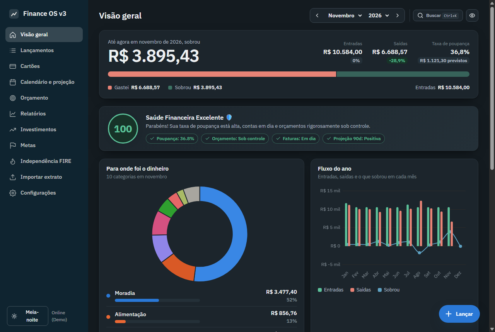
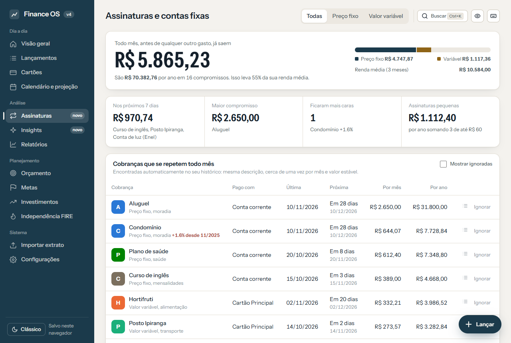
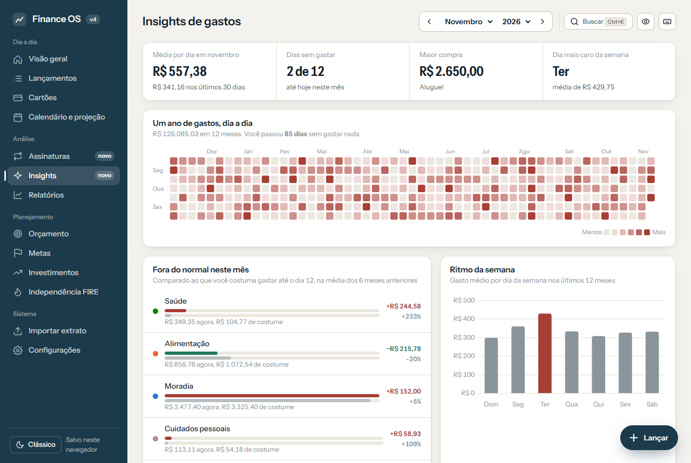
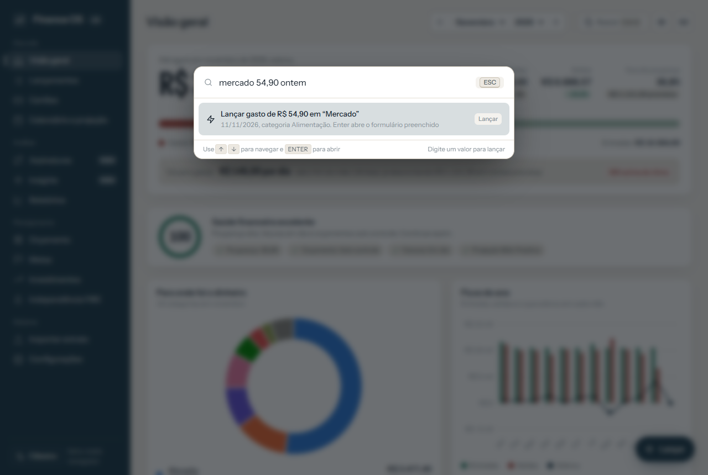
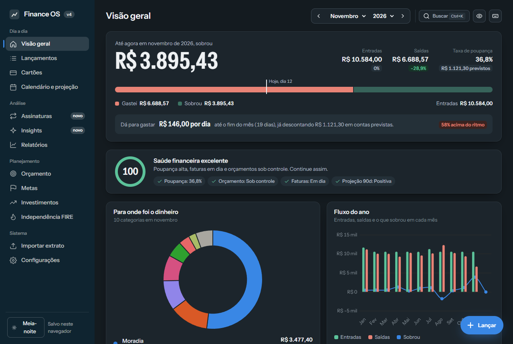
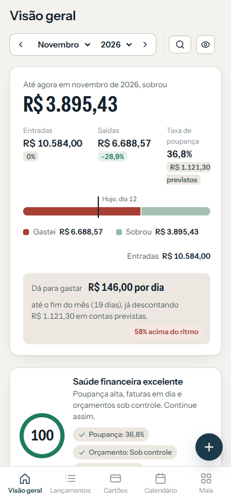
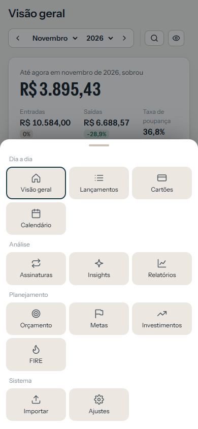
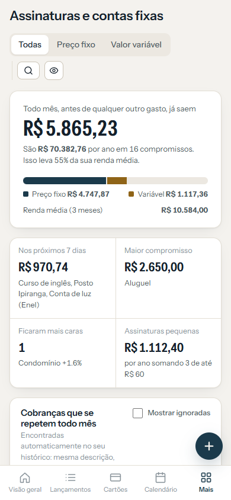
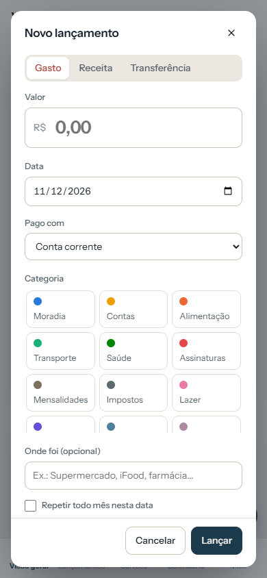
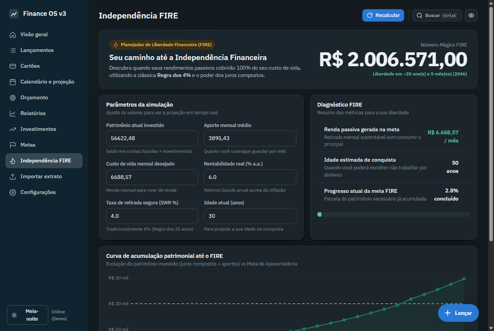

# Finance OS v4 — Controle Financeiro Pessoal

Controle financeiro completo para uso pessoal, sem planilha: contas, cartões de crédito com fatura e parcelas, recorrências, orçamento, metas, investimentos, simulador de independência financeira (FIRE), projeção de caixa, score de saúde financeira e importação de extratos.

Funciona tanto **100% no navegador via GitHub Pages (offline/local)** quanto em um **servidor Linux próprio (Ubuntu + FastAPI + nginx)**.

[](https://marceloasl99.github.io/dashboard-financeiro/)

👉 **Experimente a versão web agora:** [https://marceloasl99.github.io/dashboard-financeiro/](https://marceloasl99.github.io/dashboard-financeiro/)

---



## Novidades da v4

| | |
|---|---|
| **Assinaturas e contas fixas** | Detecta sozinho, no seu histórico, tudo que cobra todo mês (Netflix, aluguel, plano de saúde, luz…). Mostra custo mensal e anual, quanto da renda está comprometido, próxima cobrança e **reajustes de preço**. Dá para ignorar itens. |
| **Insights de gastos** | Mapa de calor com 12 meses de gastos dia a dia, dias sem gastar, dia da semana mais caro e **categorias fora do normal** (comparando com o que você costuma gastar até o mesmo dia do mês). |
| **Lançamento rápido** | No <kbd>Ctrl</kbd>+<kbd>K</kbd>, digite `mercado 54,90 ontem` ou `+ freela 1.200`: valor, data e tipo são entendidos e a categoria é sugerida pelo seu histórico. |
| **Quanto posso gastar por dia** | A visão geral mostra o valor diário livre até o fim do mês (já descontando contas previstas) e um marcador de ritmo na barra do mês. |
| **Navegação nova** | Menu lateral agrupado (Dia a dia, Análise, Planejamento, Sistema), aba **Mais** no celular com todas as telas, atalhos <kbd>G</kbd> + letra e lista de atalhos com <kbd>?</kbd>. |
| **Design** | Nova tipografia (Instrument Sans com números condensados), cor de destaque própria em cada tema, gráficos corretos em todos os temas escuros e score de saúde em anel. |
| **Correções** | Relatório "evolução de uma categoria" quebrava no modo GitHub Pages; gráficos usavam cores claras nos temas OLED, Nord, Esmeralda e Crepúsculo. |

<p>
  
  
</p>
<p>
  
  
</p>
<p>
  
  
  
  
</p>

> **Modo Standalone / GitHub Pages:** Seus dados e lançamentos são salvos com total privacidade no armazenamento local do seu navegador (`localStorage`). Você pode exportar e restaurar backups completos em JSON e CSV a qualquer momento em *Configurações › Backup*.

---

## O que ele faz

| Tela | O que você vê |
|---|---|
| **Visão geral** | Quanto sobrou no mês, quanto dá para gastar por dia até o fim do mês, **Score de Saúde Financeira (0-100)**, gastos por categoria, fluxo dos 12 meses, saldo das contas, faturas em aberto e alertas inteligentes (orçamento estourado, fatura vencendo, saldo projetado negativo, previstos a confirmar). |
| **Lançamentos** | Extrato com agrupamento por dia, busca por texto, filtro de período customizado (**De / Até**), conta/cartão, categoria e tipo. Clique edita; previstos podem ser confirmados com um toque. |
| **Cartões** | Fatura atual de cada cartão, limite usado, histórico de faturas, detalhe com compras e botão **Pagar fatura** (cria a transferência da conta). Parcelas aparecem nas faturas certas (3/12…). |
| **Calendário e projeção** | Vencimentos, fechamentos, recorrências e metas no mês, mais o saldo projetado dos próximos 90 dias, com aviso do primeiro dia com saldo negativo. |
| **Independência FIRE** | **Simulador de Liberdade Financeira:** calcula seu "Número Mágico" com base na Regra dos 4%, projeta o patrimônio com juros compostos + aportes e estima a idade e o ano da sua independência financeira. |
| **Assinaturas** | Cobranças recorrentes detectadas automaticamente, custo anual, parte da renda comprometida e reajustes. |
| **Insights** | Mapa de calor diário, ritmo da semana, categorias fora do normal e maiores compras do mês. |
| **Orçamento** | Limite × realizado por categoria no mês (com ajuste só para um mês) e acumulado do ano. |
| **Relatórios** | Ano empilhado por categoria, comparativo entre anos, evolução de uma categoria em 24 meses e exportação em CSV. |
| **Investimentos** | Patrimônio, alocação por classe, aportes × valor, vencimentos e liquidez, posições (FGTS incluído). Cotações opcionais (brapi/CoinGecko). |
| **Metas** | Progresso pelos lançamentos vinculados, prazo e quanto falta poupar por mês. |
| **Importar extrato** | Arraste CSV, XLSX, OFX ou PDF do banco ou do cartão. Pré-visualização com categoria sugerida (regras + histórico) e duplicados detectados. |
| **Configurações** | Gerenciamento de contas, cartões, categorias, regras de categorização, recorrências, backup/restauração, seleção visual de temas e cotações. |



---

## 🎨 Suíte de 6 Temas Visuais

O Finance OS conta com 6 paletas profissionais selecionáveis em *Configurações › Preferências* ou clicando no botão de tema na barra lateral:

1. **Clássico Claro (`light`)**: Estilo editorial, papel creme e azul petróleo clássico.
2. **Meia-noite (`dark`)**: Dark mode refinado com azul noturno profundo e verde esmeralda.
3. **OLED Puro (`oled`)**: Fundo preto absoluto (`#000000`) para máxima economia de energia em telas OLED e contraste impecável.
4. **Nord Ártico (`nord`)**: Paleta escandinava com azuis polares, cinzas frios e verde sálvia.
5. **Esmeralda (`emerald`)**: Estilo *Private Wealth*, verde floresta rico com toques dourados e menta.
6. **Crepúsculo (`sunset`)**: Tons terrosos e acolhedores de terracota, café, canela e âmbar.

---

## ⌨️ Atalhos de Teclado & Produtividade

- <kbd>Ctrl</kbd> + <kbd>K</kbd> (ou <kbd>Cmd</kbd> + <kbd>K</kbd>): **Busca global e lançamento rápido** — navegue para qualquer tela ou digite algo como `uber 23,50 ontem` para lançar.
- <kbd>N</kbd>: **Novo Lançamento** rápido em qualquer tela.
- <kbd>T</kbd>: próximo tema. <kbd>[</kbd> / <kbd>]</kbd>: mês anterior / próximo.
- <kbd>G</kbd> + letra: ir para uma tela (<kbd>G</kbd> <kbd>V</kbd> visão geral, <kbd>G</kbd> <kbd>L</kbd> lançamentos, <kbd>G</kbd> <kbd>S</kbd> assinaturas, <kbd>G</kbd> <kbd>I</kbd> insights…). <kbd>?</kbd> mostra todos.
- <kbd>P</kbd>: **Modo Privacidade** — desfoque instantâneo de saldos e valores para uso em público ou compartilhamento de tela *(passe o mouse sobre qualquer valor para espiar)*.
- **Duplo clique no resumo do mês (ruler):** Abre o formulário de lançamento.

---

## 💻 Como Rodar

### Opção 1: Direto no Navegador (GitHub Pages)
Acesse diretamente [https://marceloasl99.github.io/dashboard-financeiro/](https://marceloasl99.github.io/dashboard-financeiro/). Não requer instalação ou servidor backend; os dados são armazenados localmente no seu navegador.

### Opção 2: Localmente para Desenvolvimento (Python / FastAPI)
```bash
# 1. Clonar repositório
git clone https://github.com/marceloasl99/dashboard-financeiro.git
cd dashboard-financeiro

# 2. Criar ambiente virtual e instalar dependências
python -m venv .venv
.venv\Scripts\pip install -r requirements.txt      # Linux/Mac: .venv/bin/pip install -r requirements.txt

# 3. Gerar dados de teste (opcional)
.venv\Scripts\python scripts/demo_data.py

# 4. Iniciar servidor FastAPI
.venv\Scripts\uvicorn server.main:app --reload

# Abra http://localhost:8000 no navegador
```

### Opção 3: Instalar no Servidor Ubuntu (nginx + systemd)
Cinco comandos num Ubuntu 22.04 ou 24.04:

```bash
sudo apt install -y git
git clone https://github.com/marceloasl99/dashboard-financeiro.git
cd dashboard-financeiro
sudo bash deploy/install.sh --demo     # sem --demo começa com base vazia
# abra http://IP-DO-SERVIDOR/ no navegador
```

O script cria o usuário `finance`, instala em `/opt/finance-os`, cria o `venv`, registra o serviço `finance` no systemd (uvicorn em `127.0.0.1:8000`) e configura o virtual host do nginx.

- **HTTPS**: `sudo apt install certbot python3-certbot-nginx && sudo certbot --nginx -d seu.dominio`
- **Atualizar**: `git pull` e `sudo bash deploy/install.sh` de novo (seus dados em `/opt/finance-os/data` não são tocados).
- **Logs**: `journalctl -u finance -f`.

---

## 💾 Dados, Privacidade e Backup

- **Privacidade total**: Os cálculos e dados não são compartilhados com terceiros.
- **Formato padrão**: Centavos inteiros para evitar erros de ponto flutuante e datas em formato ISO (`AAAA-MM-DD`).
- **Backup no navegador (GitHub Pages)**:
  - *Configurações › Backup › Baixar backup completo (JSON)* exporta tudo.
  - *Escolher backup JSON* restaura a qualquer momento em qualquer navegador ou dispositivo.
  - *Lançamentos (CSV)* permite abrir seu extrato no Excel ou Google Sheets.
- **Backup no servidor Linux**:
  - Dados gravados em `data/finance.json` com backup diário automático mantido em `data/backups/`.

---

## 📐 Estrutura do Projeto

```
├── index.html, css/, js/   # Frontend otimizado para deploy estático (GitHub Pages)
├── web/                    # Frontend modular sem build (servido pelo FastAPI)
│   ├── css/app.css         # Design system com suporte a 6 temas e modo privacidade
│   ├── js/
│   │   ├── app.js          # Roteamento hash, temas e atalhos globais
│   │   ├── local_backend.js# Engine de cálculos offline compatível com o backend
│   │   ├── analytics.js    # Assinaturas, insights e lançamento rápido (funções puras)
│   │   ├── tests/          # Testes: node --test web/js/tests/
│   │   ├── components/     # Modais, ícones, toasts e command palette
│   │   └── pages/          # Visão geral, extrato, cartões, FIRE, metas, etc.
│   └── vendor/             # Chart.js bundle
├── server/                 # Backend FastAPI (models, storage, services, routers)
├── scripts/demo_data.py    # Gerador de base realista de teste
├── deploy/                 # Scripts systemd e nginx para Ubuntu
└── docs/                   # Documentação e capturas de tela
```

---

## 📄 Licença

Uso pessoal sob licença MIT. Sinta-se à vontade para clonar, customizar e utilizar para o seu próprio planejamento financeiro!
