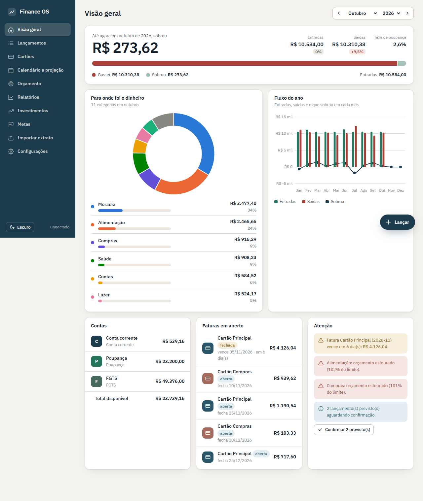

# Finance OS v2 — controle financeiro pessoal

Controle financeiro completo para uso pessoal, sem planilha: contas, cartões de crédito com fatura e parcelas, recorrências, orçamento, metas, investimentos, projeção de caixa e importação de extratos. Roda num servidor Linux seu (Ubuntu + nginx) e é usado pelo navegador, no computador e no celular.



> **Beta, usuário único.** Os dados ficam em um arquivo JSON no servidor (`data/finance.json`), com backup diário automático. Login e múltiplos usuários (SQLite/MariaDB) são a fase 2.
> A versão 1 (dashboard lendo Google Sheets) está em [`legacy/v1/`](legacy/v1/) e na tag `v1`.

## O que ele faz

| Tela | O que você vê |
|---|---|
| **Visão geral** | Quanto sobrou no mês, gastos por categoria, fluxo dos 12 meses, saldo das contas, faturas em aberto e alertas (orçamento estourado, fatura vencendo, saldo projetado negativo, previstos a confirmar). |
| **Lançamentos** | Lista por dia com filtros (período, conta/cartão, categoria, tipo, texto). Clique edita; previstos podem ser confirmados com um toque. |
| **Cartões** | Fatura atual de cada cartão, limite usado, histórico de faturas, detalhe com compras e botão **Pagar fatura** (cria a transferência da conta). Parcelas aparecem nas faturas certas (3/12…). |
| **Calendário e projeção** | Vencimentos, fechamentos, recorrências e metas no mês, mais o saldo projetado dos próximos 90 dias, com aviso do primeiro dia negativo. |
| **Orçamento** | Limite × realizado por categoria no mês (com ajuste só para um mês) e acumulado do ano. |
| **Relatórios** | Ano empilhado por categoria, comparativo entre anos, evolução de uma categoria em 24 meses, exportar CSV. |
| **Investimentos** | Patrimônio, alocação por classe, aportes × valor, vencimentos e liquidez, posições (FGTS incluído). Cotações opcionais (brapi/CoinGecko), marcadas como aproximadas. |
| **Metas** | Progresso pelos lançamentos vinculados, prazo e quanto falta por mês. |
| **Importar extrato** | Arraste CSV, XLSX, OFX ou PDF do banco ou do cartão. Pré-visualização com categoria sugerida (regras + histórico) e duplicados detectados. Nada entra sem você confirmar. |
| **Configurações** | Contas, cartões, categorias, regras de categorização, recorrências, backup/restauração, tema claro/escuro, cotações. |

O formulário de lançamento (botão **+ Lançar** ou tecla `n`) pede: tipo, valor, data, categoria, conta ou cartão, "onde foi" (opcional), parcelas (cartão) e "repetir todo mês".

Mais telas em [`docs/screenshots/`](docs/screenshots/).

## Instalar no Ubuntu (nginx + systemd)

Cinco comandos num Ubuntu 22.04 ou 24.04:

```bash
sudo apt install -y git
git clone https://github.com/marceloasl99/dashboard-financeiro.git
cd dashboard-financeiro
sudo bash deploy/install.sh --demo     # sem --demo começa vazio
# abra http://IP-DO-SERVIDOR/ no navegador
```

O script cria o usuário `finance`, instala em `/opt/finance-os`, cria o `venv`, registra o serviço `finance` no systemd (uvicorn em `127.0.0.1:8000`) e o site do nginx (`/etc/nginx/sites-available/finance-os`).

- **HTTPS**: `sudo apt install certbot python3-certbot-nginx && sudo certbot --nginx -d seu.dominio` (edite `server_name` antes).
- **Atualizar**: `git pull` na pasta clonada e `sudo bash deploy/install.sh` de novo. Os dados em `/opt/finance-os/data` não são tocados.
- **Logs**: `journalctl -u finance -f`.
- **Acesso**: a beta não tem login. Exponha só na sua rede local ou atrás de VPN/HTTPS com autenticação no nginx (`auth_basic`) até a fase 2.

## Rodar no Windows/Mac/Linux para desenvolver

```bash
python -m venv .venv
.venv\Scripts\pip install -r requirements.txt      # Linux/Mac: .venv/bin/pip
.venv\Scripts\python scripts/demo_data.py          # dados fictícios em data/finance.json
.venv\Scripts\uvicorn server.main:app --reload     # http://localhost:8000
.venv\Scripts\python -m pytest -q                  # testes
```

## Dados e backup

- Tudo fica em `data/finance.json` (valores em centavos, datas ISO). Gravação atômica a cada alteração.
- Backup diário automático em `data/backups/finance-AAAA-MM-DD.json`, mantendo 30 dias (ajustável em Configurações).
- **Configurações › Backup** baixa o JSON completo ou o CSV de lançamentos e restaura um JSON (uma cópia dos dados atuais é feita antes).
- A pasta `data/` não vai para o git.

## Como as regras funcionam

- **Fatura**: fecha no `dia de fechamento` e vence no primeiro `dia de vencimento` depois disso; é nomeada pelo mês do vencimento. Compra no dia 26 com fechamento 25 cai na próxima. Dia 31 em fevereiro vira 28/29.
- **Cartão e caixa**: a compra no cartão conta na categoria no mês da compra (orçamento, relatórios) e no caixa na data de vencimento da fatura (projeção). Pagar a fatura cria uma transferência conta → cartão.
- **Parcelas**: N lançamentos, um por mês, centavos exatos (o resto vai na primeira). Editar ou excluir pergunta "só esta ou todas as próximas".
- **Recorrências**: geram lançamentos *previstos* até 12 meses à frente; confirme com o valor real quando acontecer. Excluir a recorrência remove só os previstos.
- **Transferência** não é receita nem despesa. **FGTS** é uma conta do tipo `fgts`: entra no patrimônio, não entra no saldo disponível nem na projeção.
- **Importação**: duplicado = mesmo valor e data e descrição parecida (ou mesmo `FITID` no OFX). Em fatura de cartão, tudo é gasto exceto linhas com "pagamento", "estorno", "crédito".

## Estrutura

```
server/            FastAPI: models.py, storage/ (JSON agora, SQLite depois), services/ (faturas, parcelas,
                   recorrências, projeção, dashboard, relatórios, categorização), importers/, routers/, tests/
web/               front sem build: index.html, css/app.css, js/ (app, api, state, charts, components/, pages/)
scripts/demo_data.py   gera 14 meses de dados fictícios
deploy/            install.sh, finance.service, nginx.conf
docs/              spec, plano e screenshots
legacy/v1/         versão 1 (Google Sheets)
```

API em `/api` (documentação interativa em `/docs`). Erros vêm como `{"error": "mensagem", "field": "campo"}`.

## Fase 2 (não incluída)

Login com usuário e senha, dados por usuário em SQLite/MariaDB (a camada `storage/` já isola isso), notificações, patrimônio de bens.
